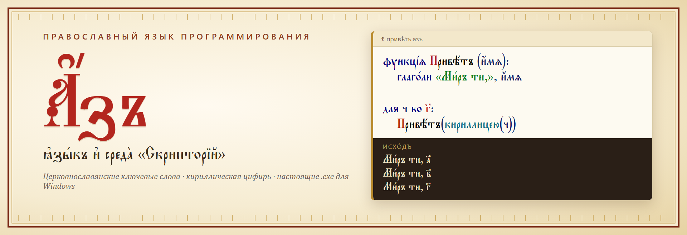
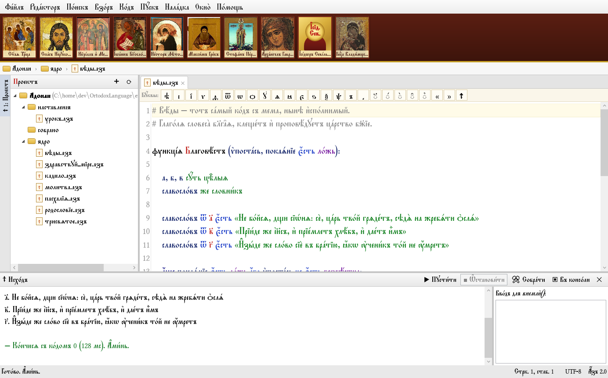
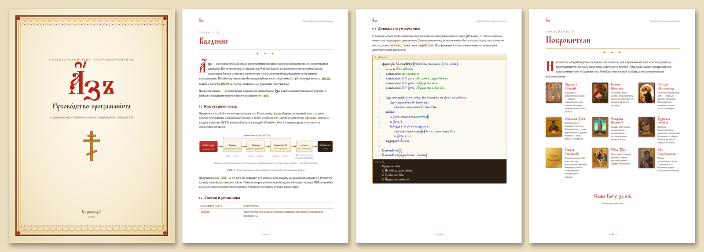
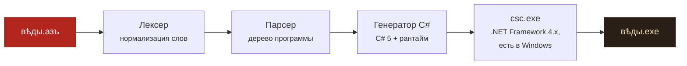

> [!NOTE]
> **Проект исследовательско-развлекательный.** Его цель — привлечь внимание к русской культуре и древнерусской
> письменности, а способ — воплотить на практике старый мем о «славянском языке программирования».
> Мы уважаем верующих, православие и любые другие традиции. Авторы против оскорблений
> по религиозным и любым другим признакам: проект не высмеивает веру и не задуман как насмешка над кем-либо.

<p align="center">
  
</p>

<p align="center">
  <b>Компилируемый язык программирования с церковнославянскими ключевыми словами<br>
  и среда разработки «Скрипторїй», в которой его приятно писать.</b>
</p>

<p align="center">
  <a href="../../releases/latest"><b>⬇ Скачать для Windows</b></a> ·
  <a href="#-первая-программа">Первая программа</a> ·
  <a href="#-руководство">Руководство (PDF)</a> ·
  <a href="docs/синтаксисъ.md">Синтаксис</a> ·
  <a href="#-как-это-устроено">Как это устроено</a>
</p>

---

Однажды в интернете появилась картинка: «православная среда разработки» с иконами вместо панели инструментов,
меню «Взоръ» и «Наладка» и программой, в которой `а҆́ще покаѧ́нїе є҆́сть ло́жь`. Это была шутка.

**Здесь эта шутка сделана всерьёз.** Код с той картинки компилируется в настоящий `.exe` и работает.

## ✦ Что внутри

| | |
|---|---|
| ☦ **Язык «Азъ»** | Синтаксис как в Python (отступы, двоеточия, `#`-комментарии), слова — церковнославянские: `функці́ѧ`, `а҆́ще`, `и҆на́че`, `поку́да`, `для … во`, `глаго́ли`, `возвратѝ`, `А҆ми́нь`. |
| ҂ **Кириллическая цифирь** | Числа можно писать буквами под титлом: `а҃` = 1, `в҃і` = 12, `҂вк҃ѕ` = 2026. Нуля в цифири нет, поэтому свитки нумеруются с единицы. |
| ⚒ **Настоящий компилятор** | `.азъ` → C# → `.exe` через компилятор .NET Framework, который уже встроен в каждую Windows 10/11. Программы получаются маленькими (≈ 20 КБ) и ни от чего не зависят. |
| ✎ **Правописание любое** | Ударения, титла и старые буквы при разборе снимаются: `є҆́сть`, `есть` и `ЕСТЬ` — одно слово. Пишите хоть по-церковному, хоть гражданской азбукой. |
| 🖥 **IDE «Скрипторїй»** | Иконостас покровителей, древо проекта, вкладки, шрифт «Пономарь», подсветка с киноварной буквицей, проверка ошибок на лету, запуск по `Shift+F10`. |
| 📜 **Руководство** | 47 страниц в PDF: от «Здравствуй, мире» до грамматики. Все 32 примера в нём при сборке компилируются и запускаются, их вывод взят из настоящего запуска. |

## ☦ Первая программа

```
глаго́ли «Здра́вствꙋй, мі́ре!»
```

А вот код с того самого мема — теперь он работает:

```
функці́ѧ Благовѣ́стъ (ѵ҆поста́сь, покаѧ́нїе є҆́сть ло́жь):
    а, б, в сꙋ́ть цѣ̑лыѧ
    славосло́въ же словни́къ
    славосло́въ ѿ а҃ є҆́сть «Не бо́йсѧ, дщи сїѡ́нѧ»
    славосло́въ ѿ в҃ є҆́сть «Прїи́де же і҆и҃съ»

    а҆́ще покаѧ́нїе є҆́сть ло́жь а҆́бо ѵ҆поста́сь не є҆́сть безвѣ́стна:
        а҆́ще славосло́въ ѿ ѵ҆поста́сь:
            глаго́ли славосло́въ ѿ ѵ҆поста́сь
    возвратѝ А҆ми́нь

Благовѣ́стъ(а҃)
```

```
> az пусти вѣды.азъ
Не бо́йсѧ, дщи сїѡ́нѧ
```

> GitHub показывает церковнославянский текст системным шрифтом, поэтому надстрочные знаки могут съезжать.
> В «Скрипторїи» и в руководстве код набран шрифтом «Пономарь» — посмотрите на баннер выше.

## 🖥 Скрипторїй

<p align="center">
  
</p>

Меню «Фа́йлъ · Реда́кторъ · По́искъ · Взо́ръ · Ко́дъ · Пꙋ́скъ · Нала́дка · Окно̀ · По́мощь», как на меме.
Сверху иконостас: Кирилл и Мефодий, Иоанн Богослов, Нестор Летописец, Максим Грек и другие покровители пишущих и переводящих.
Щелчок по иконе открывает житие. В меню «Наладка» есть пункт «Помолиться перед наладкою».

## 📜 Руководство

<p align="center">
  
</p>

Руководство программиста лежит в каждом [релизе](../../releases/latest) (`docs/Азъ — руководство.pdf`):
15 глав, 3 приложения (грамматика, шпаргалка, покровители), схемы, подсветка кода и вывод каждого примера.
Краткая справка по синтаксису — в [docs/синтаксисъ.md](docs/синтаксисъ.md), история икон с мема — в
[docs/иконы_и_покровители.md](docs/иконы_и_покровители.md).

## ⬇ Установка

**Готовая сборка.** Скачайте `Az-<версия>-win-x64.zip` со страницы [релизов](../../releases/latest), распакуйте и запустите
`Skriptorij.exe`. Ничего устанавливать не нужно: и среда, и транслятор самодостаточны. Нужна Windows 10 или 11 (x64).

**Из исходников.** Нужен [.NET 10 SDK](https://dotnet.microsoft.com/download).

```
собрать.cmd                                   # az.exe и Skriptorij.exe → bin\
скрипторий.cmd                                # запустить среду
az пусти examples\Адонаи\ядро\пасхалїѧ.азъ    # или транслятор
```

## ⚙ Как это устроено



- **Транслятор** (`src/Az.Compiler`, C# на .NET 10): лексер с нормализацией церковнославянской орфографии, рекурсивный парсер, генератор C# 5.
- **Рантайм** (`AzRuntime.cs`) вшивается в каждую программу: динамические значения, свитки и словники, буквы вместе с надстрочными знаками, вывод кириллицы в консоль.
- **Сборка** выполняется компилятором `csc.exe` из .NET Framework 4.x, который входит в Windows. Готовые программы кешируются по хешу.
- **IDE** (`src/Skriptorij`): WPF + [AvalonEdit](https://github.com/icsharpcode/AvalonEdit), подсветка и проверка ошибок тем же кодом, что и в трансляторе.

| Путь | Что там |
|---|---|
| `src/Az.Compiler/` | лексер, парсер, генератор C#, подсветка, поиск `csc.exe` |
| `src/az/` | консольный транслятор `az` |
| `src/Skriptorij/` | среда разработки; шрифт «Пономарь» и иконы вшиты в `Assets/` |
| `tests/Az.Tests/` | эталонные испытания: вывод примеров сверяется с [`tests/эталоны.json`](tests/эталоны.json) |
| `tools/Manual/` | сборщик PDF-руководства из `docs/manual/` |
| `build/package.ps1` | сборка релиза: испытания → `.exe` → руководство → zip |
| `examples/Адонаи/` | пример проекта, как на меме |
| `прототип/` | первая версия на Python + C + веб-IDE — оставлена как исторический артефакт |

```
dotnet run --project tests/Az.Tests      # эталонные испытания
dotnet run --project tools/Manual        # пересобрать руководство (нужен Microsoft Edge)
pwsh build/package.ps1 -Version 2.1      # собрать релиз в dist\
```

## 🔔 Выпуск новой версии

Релиз собирается [GitHub Actions](.github/workflows/release.yml) автоматически, когда в репозиторий приходит тег-версия:

```
git tag 2.1
git push origin 2.1
```

Подходят теги вида `1.0`, `2.1`, `2.1.3` и то же с `v` впереди. Workflow прогоняет испытания, собирает самодостаточные
`az.exe` и `Skriptorij.exe`, верстает руководство, упаковывает всё в `Az-<версия>-win-x64.zip` и публикует релиз.

## ☦ Благодарности

- Шрифт **Ponomar** — [Slavonic Computing Initiative](https://github.com/slavonic/Ponomar), SIL Open Font License.
- Изображения икон — [Викисклад](https://commons.wikimedia.org), общественное достояние; источники — в [`CREDITS.md`](src/Skriptorij/Assets/Icons/CREDITS.md).
- Редактор кода — [AvalonEdit](https://github.com/icsharpcode/AvalonEdit), MIT.
- Безымянному автору мема — за идею.

## ⚖ Лицензия

[PolyForm Noncommercial 1.0.0](LICENSE): свободно для личных, учебных, исследовательских и других некоммерческих целей.
Программы, которые вы собрали «Азомъ», — ваши: их можно использовать и распространять как угодно, в том числе
коммерчески (см. дополнительное разрешение в [LICENSE](LICENSE)). Сторонние компоненты остаются под своими
лицензиями: шрифт Ponomar — SIL OFL 1.1, AvalonEdit и .NET — MIT, иконы — общественное достояние.

<p align="center"><i>Слава Богу за всё.</i></p>
